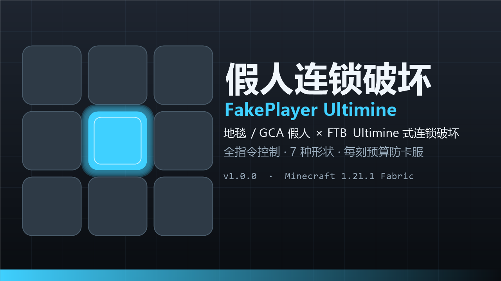

# 假人连锁破坏 · FakePlayer Ultimine

[](https://www.minecraft.net/)
[](https://fabricmc.net/)
[](LICENSE)
[](CHANGELOG.md)

让**地毯（Carpet）/ GCA 假人**在挖方块时像 [FTB Ultimine](https://modrinth.com/mod/ftb-ultimine) 一样连锁破坏周围同类方块，
用一条指令开关，服务端装上即可，客户端不需要装。

```mcfunction
/player Steve spawn
/item replace entity Steve weapon.mainhand with minecraft:diamond_pickaxe
/fakeultimine on Steve
/player Steve attack continuous
```

---

## 目录

- [功能](#功能)
- [依赖](#依赖)
- [安装](#安装)
- [快速上手](#快速上手)
- [指令](#指令)
- [形状](#形状)
- [配置文件](#配置文件)
- [行为细节](#行为细节)
- [常见问题](#常见问题)
- [实测记录](#实测记录)
- [自行构建](#自行构建)
- [下载](#下载)
- [English](#english)

---

## 功能

- **假人专用连锁**：只作用于被 `/fakeultimine on` 开启的假人，真实玩家照旧使用 Ultimine 的按键，互不干扰。
- **7 种形状**：立方体、平面、隧道、直线、连通矿脉，按需切换。
- **全指令控制**：开关、形状、上限、掉落、耐久、工具要求，均可按假人单独设置。
- **配置持久化**：设置按假人名字保存在 `config/fakeultimine.json`，重启、重新 spawn 都不丢。
- **防炸服**：单次上限 + 单假人冷却 + 全服每刻破坏预算 + 世界边界/高度检查。
- **兼容性好**：不依赖地毯 / GCA / Ultimine 的编译期 API，三者任一缺失或换小版本都不会崩服；
  装了 Ultimine 时自动遵守它的 `ftbultimine:excluded_blocks` 标签。

## 依赖

| 必需 | 说明 |
| --- | --- |
| Minecraft 1.21.1 | 仅支持此版本 |
| [Fabric Loader](https://fabricmc.net/use/installer/) 0.16+ | Java 21 |
| [Fabric API](https://modrinth.com/mod/fabric-api) 0.100+ | 使用其方块破坏事件 |
| [Carpet](https://modrinth.com/mod/carpet) 或 [GCA](https://modrinth.com/mod/gugle-carpet-addition) | 提供假人 |

| 可选 | 说明 |
| --- | --- |
| [FTB Ultimine](https://modrinth.com/mod/ftb-ultimine) | 装了则同步它的方块排除标签 |

## 安装

1. 安装 Fabric Loader（1.21.1）与 Fabric API。
2. 把本模组的 jar 放进 `mods/`。
3. 启动游戏或服务器，日志出现下面这行即成功：

```
[FakePlayerUltimine] 假人连锁破坏 v1.0.0 已加载（carpet: true, gca: true, ftbultimine: false）
```

> 单人游戏把 jar 放进整合包的 `mods/` 即可（集成服同样生效）；专用服务器只装服务端，客户端无需安装。

## 快速上手

```mcfunction
/player Steve spawn                                            # 召唤假人
/gamemode survival Steve                                       # 假人默认可能是创造模式
/item replace entity Steve weapon.mainhand with minecraft:diamond_pickaxe
/tp Steve 0 -60 0 270 0                                        # 摆好位置，朝向决定隧道方向
/fakeultimine on Steve                                         # 开启连锁
/player Steve attack continuous                                # 开始挖（attack = 左键）
/player Steve stop                                             # 停止
```

两个容易踩的坑：

- 地毯的挖掘动作是 **`attack`**（左键），`use` 是右键，没有 `mine` 这个动作。
- 指令的 `<假人>` 是实体选择器，**假人必须在线**。

## 指令

`/fakeultimine` 与 `/ful` 完全等价，需要权限等级 ≥ 2（可在配置改）。

| 指令 | 作用 |
| --- | --- |
| `/ful on <假人>` | 开启该假人的连锁破坏 |
| `/ful off <假人>` | 关闭 |
| `/ful toggle <假人>` | 切换 |
| `/ful all <true\|false>` | 一键开关当前所有在线假人 |
| `/ful list` | 列出已开启的假人 |
| `/ful status [假人]` | 查看全局 / 单个假人的配置 |
| `/ful shape <假人> <形状>` | 设置形状 |
| `/ful max <假人> <1-4096>` | 单次连锁最多破坏多少方块 |
| `/ful drop <假人> <true\|false>` | 连锁部分是否掉物品 |
| `/ful durability <假人> <true\|false>` | 是否消耗工具耐久（false = 完全不磨损） |
| `/ful tool <假人> <true\|false>` | 是否要求手持正确工具 |
| `/ful shapes` | 列出所有形状 |
| `/ful reload` | 重载 `config/fakeultimine.json` |
| `/ful prune` | 清理已关闭的假人记录 |
| `/ful help` | 帮助 |

## 形状

| id | 说明 | 适用场景 |
| --- | --- | --- |
| `cube3` | 3×3×3 立方体（默认） | 通用、挖矿 |
| `cube5` | 5×5×5 立方体 | 暴力清场（注意上限） |
| `plane3` | 与挖掘方向垂直的 3×3 平面 | 挖墙面、平整 |
| `plane5` | 5×5 平面 | 大面积平整 |
| `tunnel` | 3×3 截面隧道，沿挖掘方向延伸 | 假人挖矿道 |
| `line` | 1×1 直线 | 钻孔、垂直挖 |
| `vein` | 同类方块连通矿脉 | 挖钻石、砍树 |

形状朝向取假人的视线方向。

## 配置文件

路径：`config/fakeultimine.json`（首次启动生成，改完 `/ful reload` 热重载）

```json
{
  "permissionLevel": 2,
  "maxBlocks": 64,
  "maxBlocksPerTick": 512,
  "cooldownTicks": 4,
  "defaultShape": "cube3",
  "requireCorrectTool": false,
  "dropItems": true,
  "damageTool": true,
  "allowRealPlayers": false,
  "respectBlacklist": true,
  "respectUltimineTags": true,
  "debug": false,
  "bots": {
    "Steve": { "enabled": true, "shape": "tunnel", "maxBlocks": 64 }
  }
}
```

| 字段 | 说明 |
| --- | --- |
| `permissionLevel` | 使用指令的最低权限等级 |
| `maxBlocks` | 单次连锁上限（含原方块） |
| `maxBlocksPerTick` | **全服**每游戏刻最多额外破坏多少方块，防炸服 |
| `cooldownTicks` | 同一假人两次连锁的最小间隔（刻），0 = 每次挖掘都连锁 |
| `defaultShape` | 新假人的默认形状 |
| `requireCorrectTool` | 是否要求手持正确工具 |
| `dropItems` / `damageTool` | 是否掉物品 / 是否消耗耐久 |
| `allowRealPlayers` | 允许给真实玩家开启（默认只有假人） |
| `respectBlacklist` | 遵守本模组 `fakeultimine:blacklist` 标签 |
| `respectUltimineTags` | 遵守 `ftbultimine:excluded_blocks` 标签 |
| `debug` | 每次连锁往日志写一行 |
| `bots` | 每个假人的独立设置，按名字保存 |

黑名单标签：`data/fakeultimine/tags/block/blacklist.json`，默认含基岩、屏障、命令方块、刷怪笼等。

## 行为细节

- **只挖同一种方块**：原方块是石头就只连锁石头，不碰旁边的矿石、木头。
- **触发点在原方块被真正挖掉之后**，所以原方块的掉落、经验、工具消耗、统计仍由原版处理。
- **永远不碰**：硬度 -1 的方块、世界边界外、高度限制外、黑名单方块。
- **工具挖断即停止**，不会出现“无镐连锁”。
- `durability=false` 时该假人**完全不掉耐久**（连锁方块和它亲手挖的那块都不掉）。
- 假人是创造模式也能用；`dropItems=true` 时创造模式仍不掉落（原版行为）。
- 多个假人同 tick 连锁受 `maxBlocksPerTick` 约束。

## 常见问题

**开了没反应？**
依次检查：假人手上有没有工具、周围有没有同种方块、方块是否在黑名单、假人是否在别的维度、配置是否生效。
把 `debug` 改成 `true` 后能在日志里看到每次连锁的记录。

**提示“不是假人”？**
该玩家是真实玩家。要么用 `/player 名字 spawn` 召出的假人，要么把配置里 `allowRealPlayers` 改成 `true`。

**会和 FTB Ultimine 冲突吗？**
不会。真实玩家照旧用 Ultimine 的按键连锁，本模组只处理被开关的假人。

**服务器会卡吗？**
默认 `maxBlocks=64`、`cooldownTicks=4`、`maxBlocksPerTick=512` 已比较保守；假人多时把 `cooldownTicks` 调到 10 以上。

## 实测记录

在 Fabric 1.21.1 服务端（Carpet 1.4.147 + GCA 2.12.10）实测：

| 测试 | 结果 |
| --- | --- |
| 开启连锁后挖 3×3×3 石头 | 约 2 秒内 27 个方块全部消失 |
| 同条件关闭连锁 | 2 秒只挖掉 3 个 |
| `tunnel` + 上限 64 | 一次挖掉 63 个额外方块 |
| `plane3` | 一次挖掉 8 个额外方块 |
| `drop=true` / `false` | 掉落 27 个圆石 / 连锁部分不掉落 |
| `durability=true` / `false` | 27 方块 = 27 耐久 / 0 损耗 |
| `tool=true` + 拿锹挖石头 | 不触发连锁 |
| 重启服务器 | 开关与形状从配置恢复 |

## 自行构建

需要 JDK 21：

```bash
./gradlew build
# 产物：build/libs/fakeultimine-1.0.0.jar
```

## 下载

- GitHub Releases：<https://github.com/TTTQFS/fakeultimine/releases>
- Modrinth：<https://modrinth.com/mod/fakeultimine>
- MC百科：<https://www.mcmod.cn/class/XXXX.html>
- 夸克网盘：<https://pan.quark.cn/s/50afbd4aa709>

## 常见版本

| 模组版本 | Minecraft | 说明 |
| --- | --- | --- |
| 1.0.0 | 1.21.1 | 首个版本 |

## English

**FakePlayer Ultimine** is a small server-side Fabric addon for Minecraft 1.21.1 that gives
[Carpet](https://modrinth.com/mod/carpet) / [GCA](https://modrinth.com/mod/gugle-carpet-addition) fake players
FTB Ultimine–style chain breaking, controlled entirely by commands.

```mcfunction
/player Steve spawn
/fakeultimine on Steve
/player Steve attack continuous
```

Commands: `/ful on|off|toggle|all|list|status|shape|max|drop|durability|tool|shapes|reload|prune`.
Shapes: `cube3`, `cube5`, `plane3`, `plane5`, `tunnel`, `line`, `vein`.
Requires Fabric API; Carpet or GCA for the fake players. Client install not needed.

## 许可

[MIT](LICENSE)
